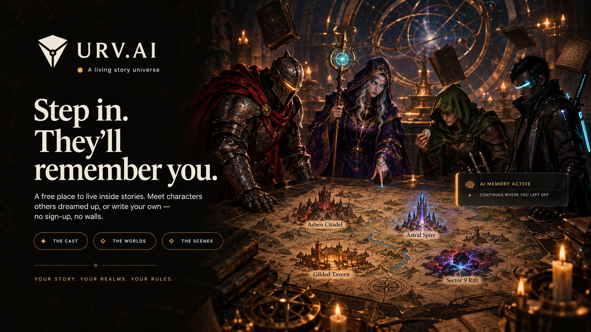

<picture>
  <source media="(prefers-color-scheme: dark)" srcset="u-r-valuable-dark.svg">
  
</picture>

# URV AI

**Understanding · Reasoning · Value**

A free roleplay AI chat in your browser.

 

---

## What is URV AI?

URV AI is a free roleplay chat platform that runs in your browser. Create your own characters, build story worlds, and have unfiltered conversations. No sign-up required.

---

## What can you do?

### Roleplay & characters

- Chat with AI characters in any scenario
- Put multiple characters in the same conversation
- Create your own characters with custom names, personalities, and backstories
- Import character cards from common formats like SillyTavern, PNG, Chub AI, and more
- Switch characters mid-session without losing context

### Worldbuilding & lore

- Build lore in the built-in Lorebook: places, factions, relationships, and events that the AI remembers throughout the chat
- Set a custom scenario or world description for each chat
- Memory anchoring keeps the story consistent across long sessions

### AI models & APIs

- Switch freely between multiple AI models and pick whatever works best for your story
- Runs on OpenAI-compatible and Anthropic-compatible APIs, so URV AI can route across multiple providers without changing how you chat

### Image generation

- Generate images inside the chat to illustrate your characters and scenes

### Quality of life

- Dark and light theme
- Custom chat wallpapers
- Branching chat history: go back to any point and take the story in a new direction
- Mobile friendly
- Interface in 12 languages: English, Bahasa Indonesia, Deutsch, Français, Español, Italiano, 中文（简体）, Русский, 日本語, हिन्दी, العربية, فارسی

---

## How to get started

1. Go to [urv-ai.vercel.app](https://urv-ai.vercel.app) or open the app directly at [perchance.org/urv-ai-chat](https://perchance.org/urv-ai-chat)
2. Pick a model
3. Create a character or start chatting right away

---

## Importing characters

URV AI supports common character card formats like SillyTavern, PNG, Chub AI, and more. If you have cards from SillyTavern, Chub AI, or compatible apps, you can import them directly.

---

## URV Hub

Explore character cards shared by creators.

---

## Free, always

URV AI is free to use and will stay free. No premium tiers, no message limits, no hidden paywalls.

---

## Credits

URV AI is built and maintained by [WithThatWay](https://perchance.org/withthatway) and runs on:

| | | |
| :---: | :---: | :---: |
|  |  |  |
| **[Perchance](https://perchance.org)** Hosting platform | **[Pollinations AI](https://pollinations.ai)** LLM API partner | **[TomdacatAI](https://ai.tomdacat.com)** LLM API partner · Robux for Roblox creators |

---

 URV AI · V2 · Understanding · Reasoning · Value

